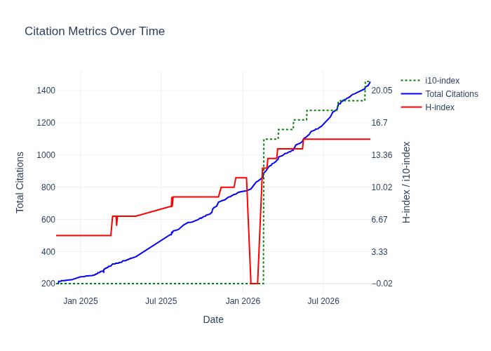
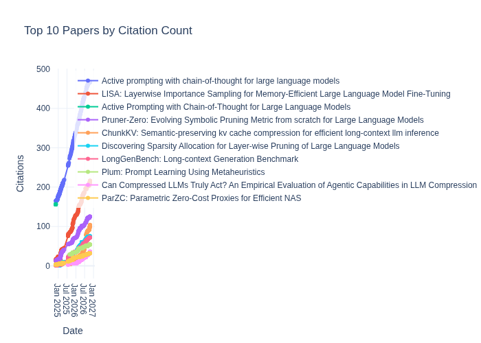

# Citation Statistics

Last updated: 2026-10-22

## Overall Statistics
- Total Citations: 1490
- H-index: 15
- i10-index: 22

## Today's Citation Changes

Total increase: +0 citations

No paper-level citation changes recorded today.

## Paper Citations

| Paper | Citations | Year |
| ----- | --------- | ---- |
| Active prompting with chain-of-thought for large language models | 468 | 2023 |
| LISA: Layerwise Importance Sampling for Memory-Efficient Large Language Model Fine-Tuning | 216 | 2024 |
| Pruner-Zero: Evolving Symbolic Pruning Metric from scratch for Large Language Models | 125 | 2024 |
| ChunkKV: Semantic-preserving kv cache compression for efficient long-context llm inference | 104 | 2025 |
| Discovering Sparsity Allocation for Layer-wise Pruning of Large Language Models | 75 | 2024 |
| LongGenBench: Long-context Generation Benchmark | 72 | 2024 |
| Plum: Prompt Learning Using Metaheuristics | 54 | 2024 |
| Can Compressed LLMs Truly Act? An Empirical Evaluation of Agentic Capabilities in LLM Compression | 36 | 2025 |
| ParZC: Parametric Zero-Cost Proxies for Efficient NAS | 32 | 2024 |
| Can LLMs Maintain Fundamental Abilities under KV Cache Compression? | 28 | 2025 |
| Dissecting the Runtime Performance of the Training, Fine-tuning, and Inference of Large Language Models | 27 | 2023 |
| Should We Really Edit Language Models? On the Evaluation of Edited Language Models | 26 | 2024 |
| 3D Question Answering for City Scene Understanding | 24 | 2024 |
| EssayJudge: A Multi-Granular Benchmark for Assessing Automated Essay Scoring Capabilities of Multimodal Large Language Models | 23 | 2025 |
| Mediator: Memory-efficient llm merging with less parameter conflicts and uncertainty based routing | 17 | 2025 |
| The Lottery LLM Hypothesis, Rethinking What Abilities Should LLM Compression Preserve? | 15 | 2025 |
| -mem: Efficient Online Memory for Large Language Models | 14 | 2026 |
| Perovskite-LLM: Knowledge-Enhanced Large Language Models for Perovskite Solar Cell Research | 14 | 2025 |
| OracleKV: Oracle Guidance for Question-Independent KV Cache Compression | 14 | 2025 |
| LPZero: Language Model Zero-cost Proxy Search from Zero | 13 | 2024 |
| DiffAdapt: Difficulty-Adaptive Reasoning for Token-Efficient LLM Inference | 10 | 2026 |
| Cafes: A collaborative multi-agent framework for multi-granular multimodal essay scoring | 10 | 2025 |
| FlowKV: Enhancing Multi-Turn Conversational Coherence in LLMs via Isolated Key-Value Cache Management | 9 | 2025 |
| City-VLM: Towards Multidomain Perception Scene Understanding via Multimodal Incomplete Learning | 8 | 2025 |
| Antkv: Anchor token-aware sub-bit vector quantization for kv cache in large language models | 6 | 2025 |
| Semantic Integrity Matters: Benchmarking and Preserving High-Density Reasoning in KV Cache Compression | 6 | 2025 |
| MDN: Parallelizing Stepwise Momentum for Delta Linear Attention | 5 | 2026 |
| SONIC: Segmented optimized nexus for information compression in key-value caching | 5 | 2026 |
| Beyond single embeddings: Capturing diverse targets with multi-query retrieval | 5 | 2025 |
| Ssr: Speculative parallel scaling reasoning in test-time | 5 | 2025 |
| LLM Agent Memory: A Survey from a Unified Representation–Management Perspective | 4 | 2026 |
| Liuyue, Bo Li, Xuming Hu, and Xiaowen Chu. ChunkKV: Semantic-preserving KV cache compression for efficient long-context LLM inference | 4 | 2026 |
| δ-mem: Efficient online memory for large language models, 2026 | 3 | 2024 |
| NestedKV: Nested Memory Routing for Long-Context KV Cache Compression | 2 | 2026 |
| Reasoning Language Model Inference Serving Unveiled: An Empirical Study | 2 | 2026 |
| Janus-Q: End-to-End Event-Driven Trading via Hierarchical-Gated Reward Modeling | 2 | 2026 |
| Liuyue, Bo Li, Xuming Hu, and Xiaowen Chu. 2026a. ChunkKV: Semantic-preserving KV cache compression for efficient long-context LLM inference | 2 | N/A |
| Chunkkv: Semantic-preserving kv cache compression for efficient long-context llm inference, 2025c | 2 | N/A |
| CoT-Core: Accelerating LLM Evaluation via CoT-Aware Coreset Selection | 1 | 2026 |
| LongStraw: Long-Context RL Beyond 2M Tokens under a Fixed GPU Budget | 1 | 2026 |
| Position: LLM Inference Should Be Evaluated as Energy-to-Token Production | 1 | 2026 |
| Macaron-V1: Towards Open Continual Learning with Self-Improvement and Mixture-of-LoRA | 0 | 2026 |
| Introducing Macaron-V1 | 0 | 2026 |
| UI4A: A Component-Native Harness for Generative UI | 0 | 2026 |
| Macaron-V1-Preview: 749B MoL Agent Model post-trained from GLM5.1 | 0 | 2026 |
| On the Scaling of PEFT: Towards Million Personal Models of Trillion Parameters | 0 | 2026 |
| MinT: Managed Infrastructure for Training and Serving Millions of LLMs | 0 | 2026 |
| An Improved Autoregressive Evaluation Paradigm for Large Language Models | 0 | 2026 |
| From Literature to Lab: Closed-Loop Advancement of Perovskite Solar Cells via Domain Knowledge Guided LLM | 0 | 2026 |
| Enhancing Knowledge Injection with Surrounding Backgrounds in Continual Training LLMs | 0 | N/A |
| Is Privacy Always Prioritized over Learning? Probing LLMs' Value Priority Belief under External Perturbations | 0 | N/A |

## Citation History

| Date | Total Citations | H-index |
| ---- | --------------- | ------- |
| 2026-10-22 | 1490 | 15 |
| 2026-10-21 | 1490 | 15 |
| 2026-10-20 | 1488 | 15 |
| 2026-10-19 | 1482 | 15 |
| 2026-10-18 | 1479 | 15 |
| 2026-10-17 | 1472 | 15 |
| 2026-10-16 | 1457 | 15 |
| 2026-10-15 | 1457 | 15 |
| 2026-10-14 | 1450 | 15 |
| 2026-10-13 | 1448 | 15 |

## Citation Trends

### Interactive Dashboard
[Open citation dashboard](dashboard.html)

### Overall Trends

### Individual Paper Trends

*For interactive charts, see [citation_trends.html](citation_trends.html) and [paper_trends.html](paper_trends.html)*